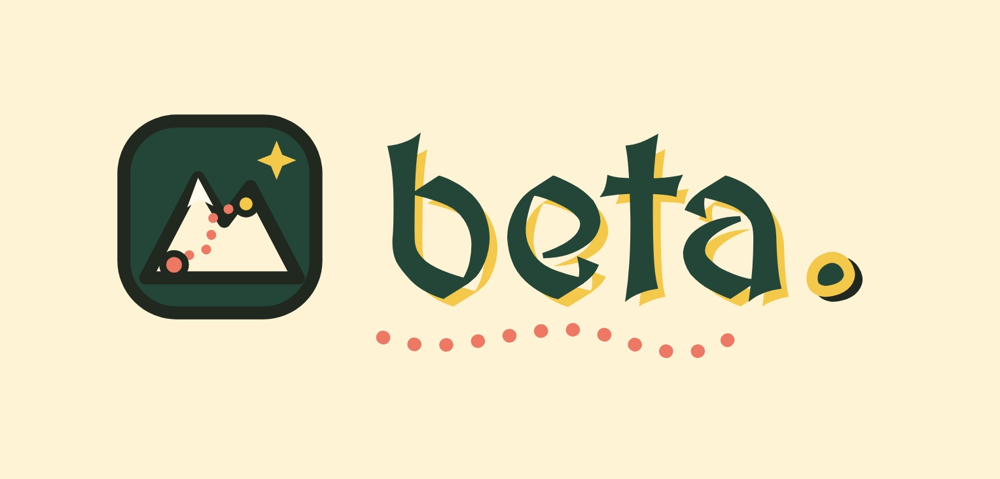

<p align="center">
  
</p>

# Beta

Beta is a climbing coach for bouldering. You upload a photo of the wall, film yourself climbing it, and get feedback that points to the exact hold and the exact second in your video. Then you can put on a Meta Quest 2 and watch the route climbed in 3D before you try it.

We built it for HackTX 2026.

## What's in this repo

| Folder | What it is |
| --- | --- |
| [`frontend/`](frontend/) | The web app: a React + TypeScript site and a small Express server that talks to Gemini and Meta's Muse Spark. Setup details are in [`frontend/README.md`](frontend/README.md). |

The full Unity project isn't in this repo, but the two VR playback scripts, `WhamMeshPlayer.cs` and `WhamPauseController.cs`, are in the main folder.

## Run the web app

You need Node 20.19 or newer, a Gemini API key (Google AI Studio), and a Meta Model API key (dev.meta.ai).

```bash
cd frontend
npm install
cp .env.example .env    # paste your GEMINI_API_KEY and MODEL_API_KEY into .env
npm run dev
```

Then open http://localhost:5173. Your keys stay in `.env`, which is git-ignored, and only the server uses them.

## How it works

### Web app

1. **Upload a wall photo.** Gemini finds every hold and its color.
2. **Pick your route.** Choose the hold color you're climbing, and Beta numbers those holds from start to finish.
3. **Add your climb.** Enter your height, wingspan and experience, then upload a video. Gemini watches it and writes down each move: the time, which hand or foot moved, and which numbered hold it went to.
4. **Get coached.** Muse Spark takes that report and your measurements and tells you what worked, what to fix, and a drill for each fix. Every timestamp in the feedback is clickable and jumps the video to that moment.
5. **Bring friends.** Up to four people can add clips of the same wall. Beta suggests who should show who which move and plans a session together. There's also a chat for follow-up questions.

### VR

- We filmed someone climbing the same wall we use in the web app demo and ran the video through [WHAM](https://github.com/yohanshin/WHAM) (in a conda environment on WSL2 Ubuntu). That gave us a full SMPL body mesh for every frame: 747 frames, 6,890 vertices each.
- Unity can't read WHAM's output, so a Python exporter converts it into our own binary file (`climber_motion_route.bytes`, about 59 MB) with the vertices and triangles for every frame.
- In Unity 6 with the Meta XR SDK, `WhamMeshPlayer.cs` loads that file and plays it back as a mesh at 30 FPS. `WhamPauseController.cs` lets you pause and resume with the A button on the right controller.
- The wall is a scanned 3D model set in a castle scene. We lined up the climber with the wall by hand and placed red holds where its hands and feet land.

## Built with

React, TypeScript, Vite, Tailwind CSS, Node.js, Express, Gemini, Meta Muse Spark, Unity 6, C#, Meta XR SDK, Meta Quest 2, WHAM, SMPL, Python

## What's next

- Build the VR wall automatically from the holds Gemini finds, so any wall you upload shows up in the headset.
- Resize the VR climber to match your height and wingspan.
- Run your own climb through WHAM and watch it next to the example in VR.
- Connect the website and the headset, so the route you pick online is the one you see in VR.
